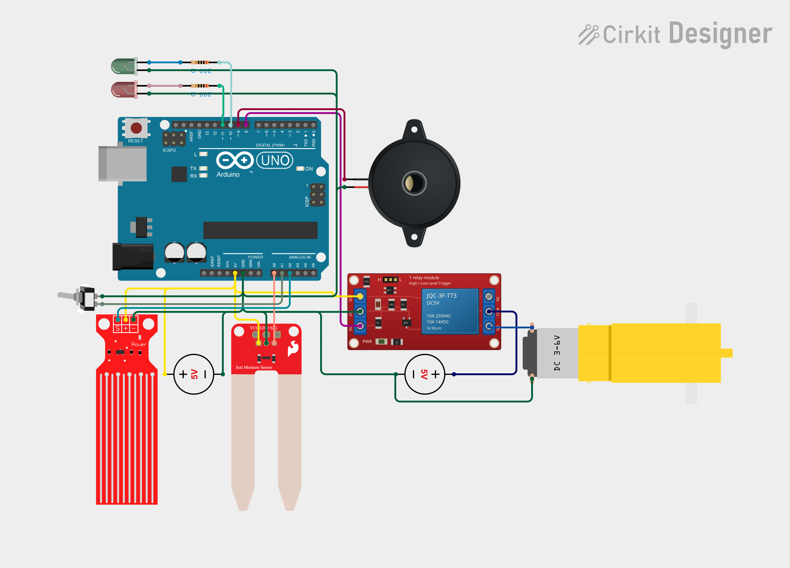

# Automatic Plant Watering Controller

Arduino UNO-based automatic watering controller with soil moisture sensing, tank-water availability checks, bounded pump cycles, and an empty-tank alarm.

## What it does

- Reads soil moisture from A0 (dry when >= 600).
- Reads a tank switch on A1 (closed = water available, open = empty) with debouncing.
- Runs a 5V relay on pin 8 to drive a DC gear motor used as a mini-pump load.
- Signals status with a green LED (pin 10, system OK) and red LED (pin 11, tank empty).
- Plays an alarm melody on a piezo buzzer (pin 9) when the tank is empty.
- Limits each watering run to 5 seconds and enforces a 30-second rewatering delay.

## Quick start

1. Open `sketch.ino` in the Arduino IDE.
2. Select **Arduino UNO** and the correct COM port.
3. Upload the sketch.
4. Open the Serial Monitor at 9600 baud to see soil/tank status.

## Wiring summary

| Pin | Component | Notes |
|-----|-----------|-------|
| A0 | Soil moisture sensor | Analog read; dry >= 600 |
| A1 | SPST tank switch | INPUT_PULLUP; closed = water |
| A2 | Water-level sensor | Reserved; not read by sketch |
| 8 | Relay module (active-low) | LOW = pump on |
| 9 | Piezo buzzer | Alarm melody |
| 10 | Green LED | System OK |
| 11 | Red LED | Tank empty / alarm |

## Interactive circuit

View and edit the circuit online:

[Open in Cirkit Designer](https://app.cirkitdesigner.com/project/10226882-e790-4eb3-85e8-ad76758a72bc)

## Important

- The tank switch on A1 simulates **both** tank checks; the separate water-level sensor wired to A2 is **not used** by the current sketch.
- The relay is active-low: `LOW` energizes the pump.
- Each pump cycle is capped at 5 seconds to prevent runaway watering.

## Docs

Extended documentation lives in [`docs/`](./docs):

- [`PLAN.md`](docs/PLAN.md) — project plan and goals
- [`DESIGN.md`](docs/DESIGN.md) — system design and behavior
- [`CODE.md`](docs/CODE.md) — code walkthrough
- [`CAUTION.md`](docs/CAUTION.md) — cautions and known limitations
