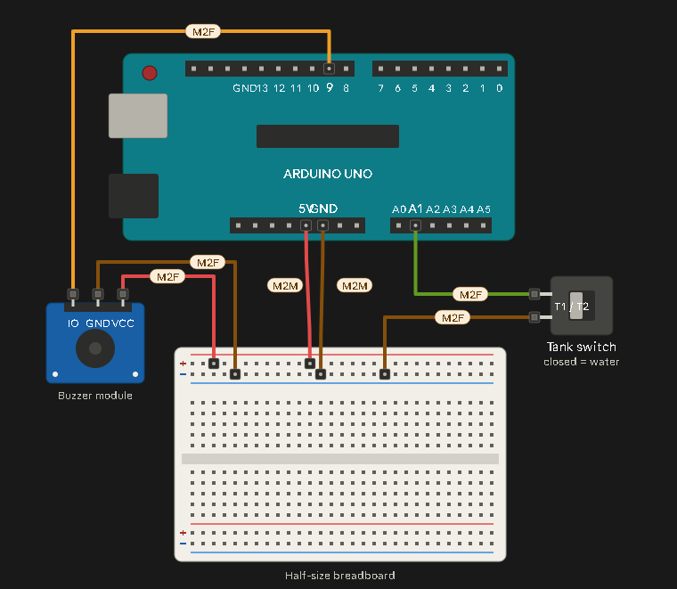

# Buzzer Alarm Test (Arduino Uno)

A small test project: an Arduino Uno plays an alarm melody on a buzzer when the A1 input is disconnected from GND, and goes silent when it is connected.

**Status:** Working. Tested with the Uno powered from a PC USB port and from a 5 V adapter.

---

## 1. How it works

| A1 input | Meaning | Buzzer |
|---|---|---|
| Connected to GND (LOW) | Switch closed or jumper in place | Silent |
| Disconnected (HIGH) | Switch open or jumper removed | Alarm melody plays |

A1 uses `INPUT_PULLUP`, so no external resistor is needed. You can use either a switch or a single jumper wire between A1 and GND. The input is debounced for 30 ms.

---

## 2. Parts

| Part | Notes |
|---|---|
| Arduino Uno | |
| Half-size breadboard | Only the + and − rails are used |
| Buzzer module | 3 pins: VCC, GND, IO. Must be **passive** to play the melody |
| Switch (optional) | Or use one jumper from A1 to the − rail |
| Jumper wires | M2M and M2F |
| USB A-to-B cable | Power and upload |

---

## 3. Pin map

| Arduino pin | Connected to |
|---|---|
| 5V | Breadboard + rail |
| GND | Breadboard − rail |
| D9 | Buzzer IO |
| A1 | − rail (jumper) or switch |

---

## 4. Jumper wire types

| Type | Ends | Use here |
|---|---|---|
| **M2M** | male to male | Uno socket to breadboard hole (5V, GND, A1) |
| **M2F** | male to female | Buzzer or switch pin to a socket (buzzer wires, switch wires) |
| **F2F** | female to female | Not needed in this build |

The Uno headers and breadboard holes are sockets, so wires going into them need male ends. The buzzer module has pins, so its wires need female ends.

---

## 5. Wiring

### With a jumper on A1 (simplest)

| # | From | To | Wire |
|---|---|---|---|
| 1 | Uno 5V | + rail | M2M |
| 2 | Uno GND | − rail | M2M |
| 3 | Buzzer VCC | + rail | M2F |
| 4 | Buzzer GND | − rail | M2F |
| 5 | Buzzer IO | Uno D9 | M2F |
| 6 | Uno A1 | − rail | M2M |

### With a switch instead of wire 6

| From | To | Wire |
|---|---|---|
| Switch terminal 1 | Uno A1 | M2F |
| Switch terminal 2 | − rail | M2F |

Match the buzzer wires to the labels printed on your module. The order of IO, GND and VCC may differ between modules. If the switch has three pins, use the middle pin and one outer pin.

---

## 6. Power

| Method | Notes |
|---|---|
| PC USB cable | Works. Also used for uploading |
| 5 V adapter | Works in testing |
| 5 V into the barrel jack | Below the jack's design range (about 7-12 V). It works for this light load, but the 5 V rail can sag, so use USB if you see resets or a weak buzzer |
| 7-12 V into the barrel jack | Correct use of the jack. Plug must be 5.5 × 2.1 mm, centre positive |

The Uno plus buzzer draws roughly 50 mA, so any 1 A or 2 A adapter is more than enough. The amp rating is only the maximum the adapter can supply.

---

## 7. Code

```cpp
// Tank alarm test: buzzer on D9, A1 wired to GND with a jumper.
// A1 connected to GND (LOW)  = water available -> buzzer silent
// A1 disconnected (HIGH)     = tank empty      -> alarm melody plays

const uint8_t TANK_PIN   = A1;
const uint8_t BUZZER_PIN = 9;

const unsigned long DEBOUNCE_MS = 30;

const int MELODY_NOTES[] = {
  659,622,659,622,659,494,587,523,440,0,
  262,330,440,494,0,
  330,415,494,523,0
};

const unsigned int MELODY_MS[] = {
  200,200,200,200,200,200,200,200,600,300,
  200,200,200,600,300,
  200,200,200,600,300
};

const uint8_t MELODY_LEN =
  sizeof(MELODY_NOTES) / sizeof(MELODY_NOTES[0]);

uint8_t melodyIndex = 0;
unsigned long melodyNoteStart = 0;

bool tankHasWater = false;
bool candidate = false;
bool alarmActive = false;
unsigned long candidateSince = 0;

void playCurrentNote() {
  if (MELODY_NOTES[melodyIndex] == 0) {
    noTone(BUZZER_PIN);
  } else {
    tone(BUZZER_PIN, MELODY_NOTES[melodyIndex]);
  }
}

void startMelody(unsigned long now) {
  melodyIndex = 0;
  melodyNoteStart = now;
  playCurrentNote();
}

void updateMelody(unsigned long now) {
  if (now - melodyNoteStart >= MELODY_MS[melodyIndex]) {
    melodyIndex = (melodyIndex + 1) % MELODY_LEN;
    melodyNoteStart = now;
    playCurrentNote();
  }
}

void setup() {
  pinMode(BUZZER_PIN, OUTPUT);
  noTone(BUZZER_PIN);

  pinMode(TANK_PIN, INPUT_PULLUP);

  candidate = (digitalRead(TANK_PIN) == LOW);
  tankHasWater = candidate;
  candidateSince = millis();

  Serial.begin(9600);
  Serial.println("Tank alarm test started");
}

void loop() {
  const unsigned long now = millis();

  // Debounce A1: LOW = water available, HIGH = tank empty.
  const bool raw = (digitalRead(TANK_PIN) == LOW);

  if (raw != candidate) {
    candidate = raw;
    candidateSince = now;
  }

  if (now - candidateSince >= DEBOUNCE_MS && tankHasWater != candidate) {
    tankHasWater = candidate;
    Serial.println(tankHasWater ? "Tank: water available" : "Tank: EMPTY");
  }

  if (!tankHasWater) {
    if (!alarmActive) {
      startMelody(now);
      alarmActive = true;
    }
    updateMelody(now);
  } else if (alarmActive) {
    noTone(BUZZER_PIN);
    alarmActive = false;
  }
}
```

### Settings

| Constant | Default | Meaning |
|---|---|---|
| `DEBOUNCE_MS` | 30 | Debounce time for A1 |
| `MELODY_NOTES` | see code | Note frequencies in Hz (0 = pause) |
| `MELODY_MS` | see code | Duration of each note in ms |

---

## 8. Testing

1. Wire with USB unplugged and check each wire against the table.
2. Confirm 5V goes to the + rail and GND to the − rail, and that the rails don't touch.
3. Connect the Uno to the PC with the USB cable.
4. In the Arduino IDE choose Tools, Board: Arduino Uno, select the port, and click Upload.
5. Open the Serial Monitor at 9600 baud.
6. With A1 connected to GND, the buzzer is silent and the monitor shows "Tank: water available".
7. Pull the A1 wire out. The melody plays and the monitor shows "Tank: EMPTY".
8. Plug it back in. The melody stops.

---

## 9. Troubleshooting

| Symptom | Likely cause | Fix |
|---|---|---|
| No sound | Buzzer VCC and GND swapped, or signal on D8 instead of D9 | Recheck against the buzzer's printed labels and the pin map |
| Beeps instead of a melody | Active buzzer | Use a passive buzzer. `tone()` cannot change an active buzzer's pitch |
| Serial shows "EMPTY" but no sound | Buzzer wiring problem | The code is working, so check the buzzer's three wires |
| Alarm never stops | A1 not reaching GND | Check the A1 wire and that it sits in a hole connected to the − rail |
| Resets or weak sound on an adapter | 5 V into the barrel jack | Power over USB instead |
| Any part gets hot | Wiring error | Unplug and recheck polarity |

---

## 10. Safety

- Wire with the power disconnected.
- Never connect 5V directly to GND.
- Do not exceed 12 V on the barrel jack.
- Do not connect USB and an external supply to the 5V pin at the same time.
